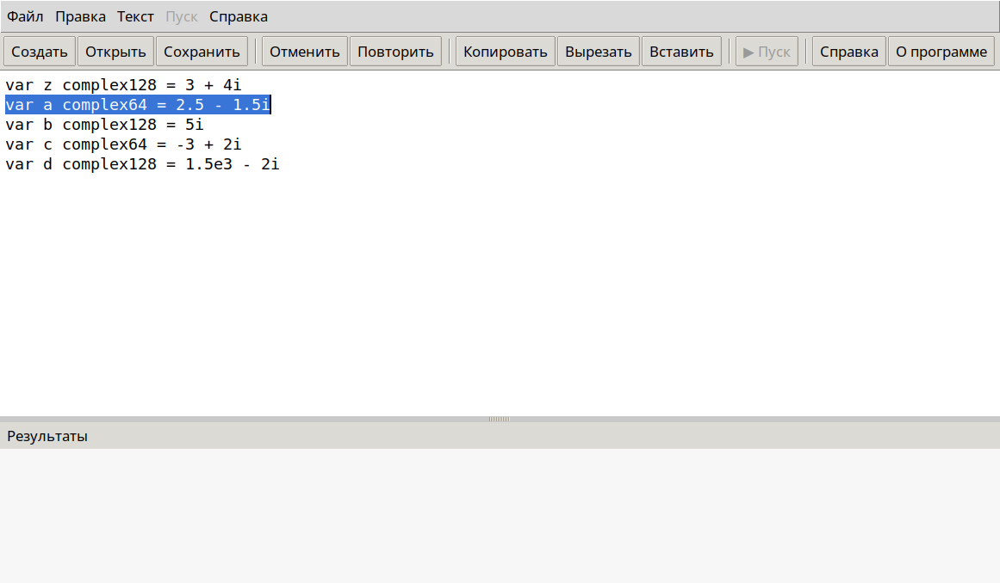
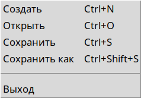
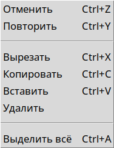
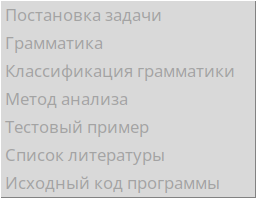
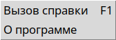
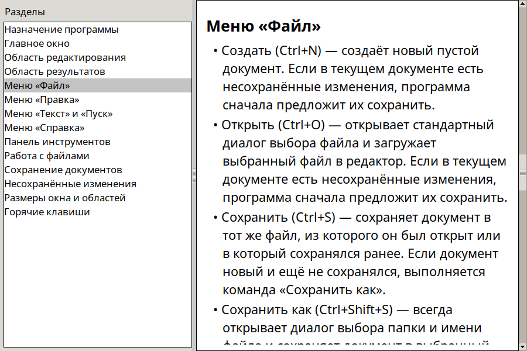
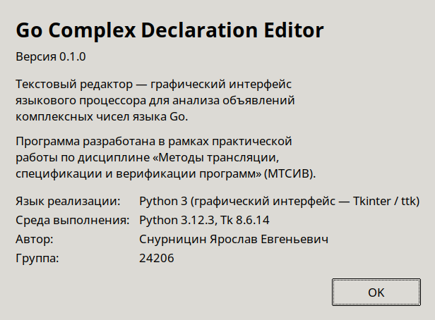
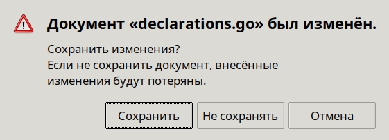
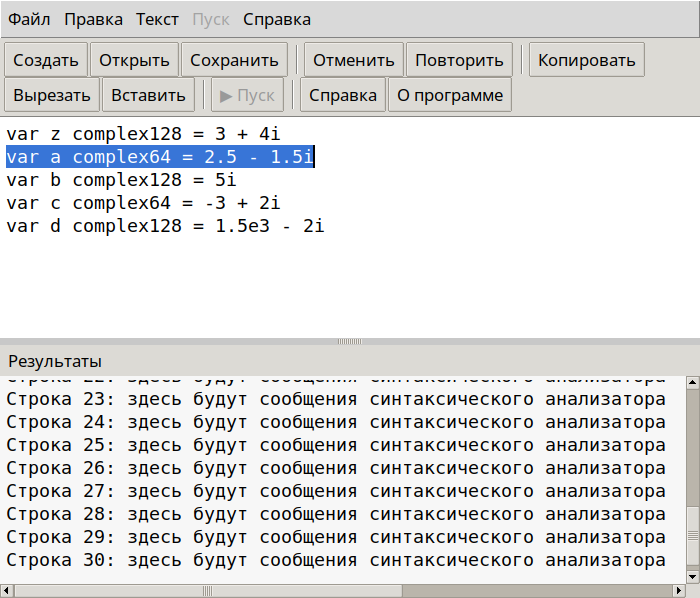

# Go Complex Declaration Editor

Текстовый редактор с графическим интерфейсом — первый этап разработки языкового
процессора для анализа **объявлений комплексных чисел в языке Go**, например:

```go
var z complex128 = 3 + 4i
var a complex64 = 2.5 - 1.5i
var b complex128 = 5i
var c complex64 = -3 + 2i
```

Практическая работа по дисциплине «Методы трансляции, спецификации и верификации программ» (МТСИВ).

> **Текущий этап — только графический интерфейс.** Синтаксический анализатор
> (команда «Пуск») и материалы меню «Текст» будут добавлены на следующих этапах.
> Сейчас введённый текст не проверяется и рассматривается как обычный текст.



## Содержание

1. [Назначение приложения](#назначение-приложения)
2. [Используемые технологии](#используемые-технологии)
3. [Требования для запуска](#требования-для-запуска)
4. [Установка зависимостей](#установка-зависимостей)
5. [Запуск](#запуск)
6. [Автономная сборка (без Python и IDE)](#автономная-сборка-без-python-и-ide)
7. [Руководство пользователя](#руководство-пользователя)
   - [Главное окно](#главное-окно)
   - [Меню «Файл»](#меню-файл)
   - [Меню «Правка»](#меню-правка)
   - [Меню «Текст» и «Пуск»](#меню-текст-и-пуск)
   - [Меню «Справка»](#меню-справка)
   - [Панель инструментов](#панель-инструментов)
   - [Работа с файлами](#работа-с-файлами)
   - [Сохранение документов](#сохранение-документов)
   - [Несохранённые изменения](#несохранённые-изменения)
   - [Изменение размеров окна и областей](#изменение-размеров-окна-и-областей)
   - [Горячие клавиши](#горячие-клавиши)
8. [Функции, которые будут реализованы позже](#функции-которые-будут-реализованы-позже)
9. [Структура проекта](#структура-проекта)
10. [Автоматические тесты](#автоматические-тесты)

## Назначение приложения

Программа — это текстовый редактор, который в дальнейшем станет языковым
процессором: он будет проверять, соответствует ли введённый текст автоматной
грамматике G[‹D›] объявления комплексного числа языка Go, и выводить сообщения
о синтаксических ошибках в область результатов.

На текущем этапе реализованы:

- главное меню и панель инструментов;
- многострочная область редактирования текста;
- область результатов (только для чтения);
- создание, открытие и сохранение файлов;
- операции правки: отмена, повтор, вырезание, копирование, вставка, удаление,
  выделение всего текста;
- предупреждение о несохранённых изменениях;
- изменение размеров окна и областей (подвижный разделитель);
- встроенная справочная система и окно «О программе»;
- горячие клавиши (работают и при русской раскладке).

## Используемые технологии

| Компонент | Что используется |
|---|---|
| Язык | Python 3 (проверено на Python 3.12.3) |
| Графический интерфейс | Tkinter и ttk (стандартная библиотека Python), Tk 8.6 |
| Сторонние пакеты для работы программы | не требуются |
| Сборка исполняемого файла | PyInstaller (только для сборки) |
| ОС | Ubuntu 24.04 (Linux) |

## Требования для запуска

- Ubuntu 22.04 / 24.04 или другой Linux с графическим окружением;
- Python 3.10 или новее (в Ubuntu 24.04 установлен по умолчанию);
- системный пакет `python3-tk` (модуль tkinter).

Для запуска **готового исполняемого файла** (см. ниже) Python не нужен.

## Установка зависимостей

Программа использует только стандартную библиотеку Python. В Ubuntu модуль
tkinter поставляется отдельным системным пакетом:

```bash
sudo apt update
sudo apt install python3 python3-tk
```

Проверка, что tkinter установлен:

```bash
python3 -c "import tkinter; print('Tk', tkinter.TkVersion)"
```

Файл `requirements.txt` не содержит пакетов (только пояснения): `pip install`
для запуска не нужен. Зависимости для сборки исполняемого файла перечислены в
`requirements-build.txt`.

## Запуск

Из терминала Ubuntu (VS Code или другая IDE не нужны):

```bash
cd compiler-gui
python3 main.py
```

Или, так как файл исполняемый:

```bash
./main.py
```

## Автономная сборка (без Python и IDE)

Чтобы программа запускалась на компьютере без установленного Python и среды
разработки, она собирается в один исполняемый файл с помощью PyInstaller.
Все необходимые модули (интерпретатор Python, tkinter, библиотеки Tcl/Tk)
помещаются внутрь этого файла.

Сборка одной командой:

```bash
./build.sh
```

Скрипт создаёт виртуальное окружение `.venv-build`, устанавливает в него
PyInstaller и выполняет сборку. То же самое вручную:

```bash
python3 -m venv .venv-build
.venv-build/bin/pip install -r requirements-build.txt
.venv-build/bin/pyinstaller --noconfirm --clean --onefile --windowed \
    --name go-complex-editor main.py
```

> Для `python3 -m venv` в Ubuntu может понадобиться пакет `python3-venv`:
> `sudo apt install python3-venv`.

Результат — файл `dist/go-complex-editor` (около 12 МБ). Запуск:

```bash
./dist/go-complex-editor
```

Файл можно скопировать на другой компьютер с Linux (x86-64) и запускать без
установки Python. На целевом компьютере нужны только стандартные графические
библиотеки (X11/XWayland, fontconfig), которые есть в любой настольной Ubuntu.
Исполняемый файл, собранный в Ubuntu 24.04, рассчитан на системы с такой же
или более новой версией glibc; для более старых систем собирайте программу на
них самих.

**Проверка сборки.** Сборка выполнена в Ubuntu 24.04 (Python 3.12.3,
PyInstaller 6); исполняемый файл запущен из отдельной папки вне проекта с
очищенными переменными окружения — главное окно открылось без ошибок.
Запуск на компьютере, где Python не установлен вовсе, не проверялся. Чтобы
проверить это самостоятельно:

```bash
# на компьютере (или в виртуальной машине) без python3-tk
./go-complex-editor
```

## Руководство пользователя

То же руководство доступно внутри программы: **Справка → Вызов справки** (F1).

### Главное окно


*Главное окно с открытым файлом `examples/declarations.go`; одна строка выделена.
Неактивный пункт «Пуск» и кнопка «▶ Пуск» — анализатор появится на следующем этапе.*

Главное окно состоит из четырёх частей (сверху вниз):

1. **Главное меню** — «Файл», «Правка», «Текст», «Пуск», «Справка».
2. **Панель инструментов** — кнопки для быстрого вызова частых команд.
3. **Область редактирования** — многострочное поле для ввода и редактирования
   текста. Текст отображается моноширинным шрифтом; Tab вставляет табуляцию
   шириной 4 пробела. Строки не переносятся: если текст не помещается,
   появляются вертикальная и горизонтальная полосы прокрутки.
4. **Область результатов** (заголовок «Результаты») — сюда будет выводить
   сообщения языковой процессор. Область доступна **только для чтения**: ввести,
   вставить или удалить в ней текст нельзя. Текст из неё можно выделить мышью и
   скопировать (Ctrl+C). Сейчас область пустая; при создании нового документа и
   открытии файла она очищается.

Между областью редактирования и областью результатов находится **подвижный
разделитель**.

В **заголовке окна** показывается имя файла (для нового документа — «Новый
документ»). Звёздочка перед именем, например `*declarations.go — Go Complex
Declaration Editor`, означает, что есть несохранённые изменения.

> На скриншотах показано содержимое окна без рамки и заголовка, которые рисует
> оконный менеджер Ubuntu.

### Меню «Файл»



| Команда | Клавиши | Действие |
|---|---|---|
| Создать | Ctrl+N | Создаёт новый пустой документ. При несохранённых изменениях сначала спрашивает, сохранить ли их. |
| Открыть | Ctrl+O | Открывает стандартный диалог выбора файла и загружает файл в редактор. При несохранённых изменениях сначала спрашивает, сохранить ли их. |
| Сохранить | Ctrl+S | Сохраняет документ в его файл. Если документ новый — работает как «Сохранить как». |
| Сохранить как | Ctrl+Shift+S | Всегда открывает диалог выбора имени и папки; сохраняет документ туда. Новое имя появляется в заголовке окна. |
| Выход | — | Закрывает программу, предварительно предложив сохранить изменения. Так же работает системная кнопка закрытия окна «×». |

### Меню «Правка»



| Команда | Клавиши | Действие |
|---|---|---|
| Отменить | Ctrl+Z | Отменяет последнее изменение текста (можно повторять многократно). |
| Повторить | Ctrl+Y, Ctrl+Shift+Z | Повторяет отменённое изменение. |
| Вырезать | Ctrl+X | Удаляет выделенный фрагмент и помещает его в буфер обмена. |
| Копировать | Ctrl+C | Помещает выделенный фрагмент в буфер обмена. |
| Вставить | Ctrl+V | Вставляет текст из буфера обмена в позицию курсора; выделенный фрагмент заменяется. |
| Удалить | — | Удаляет выделенный фрагмент (без помещения в буфер обмена). |
| Выделить всё | Ctrl+A | Выделяет весь текст документа. |

Если действие невозможно (ничего не выделено, буфер обмена пуст, нечего
отменять), команда просто ничего не делает — ошибок не возникает. История
отмены очищается при создании и открытии документа, поэтому «отменить»
загрузку файла нельзя.

### Меню «Текст» и «Пуск»



Меню «Текст» содержит пункты «Постановка задачи», «Грамматика», «Классификация
грамматики», «Метод анализа», «Тестовый пример», «Список литературы»,
«Исходный код программы». По требованиям задания они будут реализованы на
следующем этапе, поэтому сейчас **неактивны**.

Пункт главного меню **«Пуск»** и кнопка **«▶ Пуск»** будут запускать
синтаксический анализатор. Анализатор ещё не реализован, поэтому они
**неактивны**.

### Меню «Справка»



- **Вызов справки** (F1) — открывает окно справочной системы: слева список
  разделов, справа руководство пользователя. Щелчок по разделу прокручивает
  текст к нему. Окно не модальное — можно одновременно работать в редакторе.
  Закрывается кнопкой окна или клавишей Esc. Повторный вызов поднимает уже
  открытое окно, а не создаёт новое.

  

- **О программе** — окно с названием, назначением, версией программы, языком
  реализации и сведениями о практической работе. Закрывается кнопкой «OK»,
  клавишами Enter или Esc.

  

  Поля «Автор» и «Группа» — заполнители; замените их в файле `gui/app_info.py`.

### Панель инструментов

| Кнопка | Команда |
|---|---|
| Создать / Открыть / Сохранить | команды меню «Файл» |
| Отменить / Повторить | отмена и повтор изменений |
| Копировать / Вырезать / Вставить | работа с буфером обмена |
| ▶ Пуск | запуск анализатора (пока неактивна) |
| Справка / О программе | команды меню «Справка» |

Кнопки вызывают **те же обработчики**, что и пункты меню. При наведении мыши
появляется всплывающая подсказка с назначением кнопки и сочетанием клавиш.
Нажатие кнопки не забирает фокус у редактора: выделение и курсор сохраняются.

### Работа с файлами

- В диалоге открытия по умолчанию показываются файлы `.go` и `.txt`; другие
  текстовые файлы видны при выборе типа «Все файлы».
- Файлы читаются и сохраняются в кодировке **UTF-8** (русский текст
  отображается и сохраняется корректно). Метка BOM при чтении игнорируется.
- Окончания строк Windows (CR LF) при открытии преобразуются; при сохранении
  используются окончания строк Linux (LF).
- Если при сохранении не указать расширение, оно добавляется по выбранному в
  диалоге типу: `.go` («Файлы Go», по умолчанию) или `.txt` («Текстовые
  файлы»); при типе «Все файлы» имя не меняется.
- Ошибки (файл не найден, нет прав, файл не является текстом в UTF-8, папка
  недоступна) показываются в окне сообщения с причиной. Программа при этом
  не завершается, текущий документ не изменяется и не теряется.

Для проверки можно открыть пример `examples/declarations.go`.

### Сохранение документов

Программа помнит файл, связанный с документом (из которого он открыт или в
который сохранён).

1. **Новый документ** → «Сохранить» открывает диалог «Сохранить как».
2. **Документ с файлом** → «Сохранить» сразу записывает текст в этот файл.
3. «**Сохранить как**» всегда спрашивает имя; после сохранения документ
   связывается с новым файлом, имя обновляется в заголовке окна.
4. При выборе существующего файла диалог спрашивает, заменить ли его.

После успешного сохранения звёздочка в заголовке исчезает. Если сохранение не
удалось (например, нет прав на запись), выводится сообщение об ошибке, а
документ по-прежнему считается изменённым.

### Несохранённые изменения

Программа отслеживает изменение документа. Только что открытый или
сохранённый документ считается неизменённым, и программа не просит его
сохранять. После любого изменения текста в заголовке появляется `*`; если
отменить все изменения (Ctrl+Z), звёздочка исчезает.

Проверка выполняется при **создании** документа, **открытии** другого файла,
**выходе** через меню и **закрытии окна** системной кнопкой:



- **Сохранить** — документ сохраняется (для нового документа откроется диалог
  «Сохранить как»), затем действие выполняется. Если пользователь отменил
  диалог сохранения или сохранение не удалось — действие **не выполняется**.
- **Не сохранять** — изменения отбрасываются, действие выполняется.
- **Отмена** (а также Esc или закрытие диалога) — действие не выполняется,
  документ остаётся как был.

### Изменение размеров окна и областей



*Окно уменьшено: кнопки панели инструментов перенеслись на вторую строку;
разделитель сдвинут вверх; в области результатов (демонстрационный текст)
появились полосы прокрутки.*

- При изменении размеров окна обе области растягиваются и сжимаются
  (дополнительное место делится в отношении примерно 3:1 в пользу редактора).
  Меню и панель инструментов остаются на месте.
- Если окно уже панели инструментов, кнопки переносятся на следующую строку —
  все они остаются видимыми и не накладываются друг на друга.
- Минимальный размер окна — 560×420 пикселей.
- **Подвижный разделитель** между редактором и областью результатов
  перетаскивается мышью вверх или вниз. Каждая область сохраняет минимальную
  высоту (60 пикселей), поэтому её нельзя скрыть полностью.
- Полосы прокрутки появляются автоматически, только когда содержимое не
  помещается.

### Горячие клавиши

| Клавиши | Команда |
|---|---|
| Ctrl+N | Создать |
| Ctrl+O | Открыть |
| Ctrl+S | Сохранить |
| Ctrl+Shift+S | Сохранить как |
| Ctrl+Z | Отменить |
| Ctrl+Y, Ctrl+Shift+Z | Повторить |
| Ctrl+X | Вырезать |
| Ctrl+C | Копировать |
| Ctrl+V | Вставить |
| Ctrl+A | Выделить всё |
| F1 | Вызов справки |

Сочетания работают и при **русской раскладке** клавиатуры (клавиши
определяются по физическому коду). Команды правки действуют, когда курсор
находится в редакторе; Ctrl+N, Ctrl+O, Ctrl+S, Ctrl+Shift+S работают в любом
месте главного окна. В области результатов Ctrl+C и Ctrl+A копируют и
выделяют её собственный текст.

## Функции, которые будут реализованы позже

Сознательно **не реализованы** на этом этапе (по требованиям задания):

- синтаксический анализатор по автоматной грамматике G[‹D›] и команда «Пуск»;
- лексический анализ, проверка объявлений комплексных чисел;
- нейтрализация ошибок (метод Айронса);
- переход курсора к месту ошибки по щелчку на сообщении в области результатов;
- содержимое пунктов меню «Текст»;
- дополнительные возможности: изменение размера шрифта, вкладки, выбор языка
  интерфейса, нумерация строк, перетаскивание файлов в окно, строка состояния,
  подсветка синтаксиса, вывод ошибок в виде таблицы.

### Как будет подключаться анализатор

Архитектура подготовлена так, чтобы не переписывать интерфейс:

1. Анализатор размещается в отдельном модуле (например, `core/parser.py`) и не
   зависит от Tkinter: получает строку текста, возвращает список ошибок.
2. В `gui/app.py` в словаре `self.commands` вместо `"run": None` указывается
   метод, который берёт текст `self.editor.get_text()`, вызывает анализатор и
   выводит сообщения через `self.output.clear()` / `self.output.append(...)`.
   Пункт меню «Пуск» и кнопка «▶ Пуск» станут активными автоматически.
3. Пункты меню «Текст» включаются так же: достаточно добавить в
   `self.commands` обработчики с именами `text_task`, `text_grammar`,
   `text_grammar_class`, `text_analysis_method`, `text_test_example`,
   `text_references`, `text_source_code` (см. `gui/menu.py`).
4. Переход к ошибке по щелчку добавляется в `gui/output.py` (теги строк
   `tk.Text` + обработчик щелчка) и метод установки курсора в `gui/editor.py`.

## Структура проекта

```text
compiler-gui/
├── main.py                 точка входа (python3 main.py)
├── core/
│   └── file_io.py          чтение/запись файлов UTF-8, понятные сообщения об ошибках
├── gui/
│   ├── app.py              главное окно: сборка интерфейса, все команды,
│   │                       работа с документом, проверка несохранённых изменений
│   ├── menu.py             описание и построение главного меню
│   ├── toolbar.py          панель инструментов (с переносом кнопок)
│   ├── editor.py           область редактирования и операции правки
│   ├── output.py           область результатов (только чтение)
│   ├── dialogs.py          «Сохранить изменения?», «О программе», окно справки
│   ├── help_content.py     текст встроенного руководства пользователя
│   ├── shortcuts.py        горячие клавиши (в т. ч. для русской раскладки)
│   ├── widgets.py          автоскрываемые полосы прокрутки, всплывающие подсказки
│   └── app_info.py         название, версия, автор (заполнители)
├── examples/
│   └── declarations.go     пример файла для проверки
├── tests/
│   └── test_app.py         автоматические тесты интерфейса
├── docs/screenshots/       скриншоты для README
├── build.sh                сборка автономного исполняемого файла
├── requirements.txt        зависимости для запуска (нет сторонних пакетов)
├── requirements-build.txt  зависимости для сборки (PyInstaller)
└── README.md
```

Главный принцип: **все команды собраны в словаре `EditorApp.commands`**.
Меню, панель инструментов и горячие клавиши вызывают одни и те же функции,
поэтому логика не дублируется. Если функция команды равна `None`, пункт меню
и кнопка автоматически становятся неактивными.

## Автоматические тесты

Тесты создают настоящее окно программы и проверяют файловые операции,
операции правки, диалог несохранённых изменений, структуру меню, панель
инструментов, область результатов, справку, изменение размеров и горячие
клавиши. Стандартные диалоги выбора файла в тестах подменяются.

```bash
python3 -m unittest discover -s tests -v
```

Нужен графический сеанс (во время тестов на экране ненадолго появляются окна).
